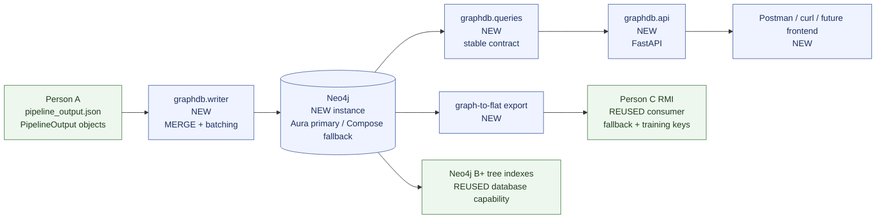

# Architecture — Graph DB & Backend lane

## 1. Position in the project

The lane sits between Person A's NLP pipeline and two consumers:

- Person C's RMI research lane, which needs a correct Neo4j fallback and a flat event-key dataset.
- A future frontend or Postman/curl client, which needs stable query endpoints.



A standalone copy lives in [diagrams/architecture.md](diagrams/architecture.md).

## 2. Components

| Component | Status | Responsibility |
|---|---|---|
| `common.schema` | **REUSED** | Shared `Article`, `Event`, `Entity`, `Topic`, `ExtractedEvent`, `ExtractionResult`, `PipelineOutput`, `EventLink` dataclasses. No edits planned. |
| `pipeline/extract.py` | **REUSED** | Source of entity normalization behaviour and event topics. No edits. |
| `pipeline/link.py` | **REUSED** | Produces confidence/reason links, already directed earlier → later. No edits. |
| `pipeline/export.py` | **REUSED** | Existing flat event-key column contract. No edits. |
| `graphdb/config.py` | **NEW, Stage 1 implemented** | Load and validate `NEO4J_*` environment variables; keep the password out of repr/logs. |
| `graphdb/connection.py` | **NEW, Stage 1 implemented** | Small driver/session wrapper behind a mockable interface. |
| `graphdb/health.py` | **NEW, Stage 1 implemented** | Connectivity/server-version report; reusable by the API `/health`. |
| `graphdb/apply_schema.py` | **NEW, Stage 1 implemented** | Apply CQL indexes/constraints, handle equivalent schema objects, verify with `SHOW INDEXES`. |
| `graphdb/indexes.cql` | **NEW, Stage 1 implemented** | Exactly the four design-doc index statements. |
| `graphdb/constraints.cql` | **NEW, Stage 1 implemented** | Four approved uniqueness constraints. |
| `graphdb/writer.py` | **NEW, Stage 2 implemented** | Idempotent, parameterized, batched graph writes; endpoint validation; global `PRECEDES` rebuild; created/matched counts. |
| `graphdb/tests/fixtures/pipeline_output.json` | **NEW, Stage 2 implemented** | Synthetic, test-only, pipeline-output-shaped fixture with 3–4 event chains. |
| `graphdb/queries.py` | **NEW, Stage 3** | Stable query contract and RMI fallback functions. |
| `graphdb/api.py` | **NEW, Stage 4** | Thin FastAPI/Pydantic layer; no business logic in routes. |
| `graphdb/export.py` | **NEW, Stage 5** | Flat event-key export from the graph. |
| `graphdb/tests/` | **NEW, Stages 1–2 implemented** | Mocked-driver unit tests and `test_`-namespaced integration tests that auto-skip without `NEO4J_URI`. |

## 3. Interfaces

### Input: Person A's contract

The writer accepts either:

1. a `common.schema.PipelineOutput` object, or
2. the JSON shape written by `pipeline.export.write_pipeline_json`.

The JSON shape is:

```text
{
  "results": [
    {
      "article": {id, title, date, source, url},
      "entities": [{id, name, type}],
      "events": [
        {
          "event": {id, description, date, type, date_source},
          "entities": [{id, name, type}],
          "topic": {name},
          "source_text": "..."
        }
      ]
    }
  ],
  "links": [{from_event_id, to_event_id, confidence, reason}]
}
```

Dates arrive as ISO strings in JSON. They must be converted to native Neo4j `date` values. [VERIFIED from `pipeline/export.py`]

### Output: Person C's fallback contract

`graphdb/queries.py` will expose at minimum:

- `events_in_date_range(start, end, limit=...) -> list[dict]`
- `event_by_id(event_id) -> dict | None`
- entity/date/topic chain functions with `min_confidence`, depth cap, result limit, and chronological order.

These are stable contracts. Changing their names, parameters, or return shapes requires review from
Person C. [PROPOSED]

### Output: flat export

The graph export keeps the existing column contract:

```text
event_id, date_key, date, date_source, type, article_id
```

`date_key = (date - 1970-01-01).days`, sorted by `(date_key, event_id)`. [VERIFIED existing convention]

## 4. Data flow

1. Person A produces `pipeline_output.json` or `PipelineOutput` objects.
2. The writer validates the input shape and link endpoints.
3. The writer batches nodes/relationships with `UNWIND` inside explicit transactions.
4. The writer rebuilds the global `PRECEDES` chain in `(date, id)` order in one transaction after the batch.
5. Queries use the `event_date`, `event_type`, `entity_name`, and `topic_name` indexes where possible.
6. FastAPI routes call `queries.py` and return Pydantic response models.
7. The flat exporter reads `Event` nodes from Neo4j and writes Person C's CSV.

## 5. Cypher model

### Nodes

| Label | Key | Properties |
|---|---|---|
| `Article` | `id` | `title`, `date` (native date), `source`, `url` |
| `Event` | `id` | `description`, `date` (native date), `type`, `date_source` |
| `Entity` | `id` | `name`, `type` |
| `Topic` | `name` | none beyond the key |

### Relationships

| Relationship | Meaning |
|---|---|
| `(Article)-[:DESCRIBES]->(Event)` | Article reported the event. |
| `(Article)-[:MENTIONS]->(Entity)` | Entity appears anywhere in the article. |
| `(Article)-[:ABOUT]->(Topic)` | Derived from the distinct topics of the article's events. |
| `(Event)-[:ABOUT]->(Topic)` | Canonical event-topic edge from `ExtractedEvent.topic`. |
| `(Event)-[:INVOLVES]->(Entity)` | Entity participates in the event. |
| `(Event)-[:PRECEDES]->(Event)` | Immediate successor in global `(date, id)` order. |
| `(Event)-[:LINKED_TO {confidence, reason}]->(Event)` | Pipeline's semantic relation. |

The `Event-ABOUT` edge extends design doc §2.3.2; `Article-ABOUT` is retained and derived. See
[ADR-0002](decisions/ADR-0002-graph-schema-and-temporal-semantics.md). `common/schema.py` does not need a
change because the topic already lives on `ExtractedEvent`.

### Indexes and constraints

The four required indexes are exactly:

```cypher
CREATE INDEX event_date  IF NOT EXISTS FOR (e:Event)  ON (e.date);
CREATE INDEX event_type  IF NOT EXISTS FOR (e:Event)  ON (e.type);
CREATE INDEX entity_name IF NOT EXISTS FOR (n:Entity) ON (n.name);
CREATE INDEX topic_name  IF NOT EXISTS FOR (t:Topic)  ON (t.name);
```

The approved uniqueness constraints are on `Article.id`, `Event.id`, `Entity.id`, and `Topic.name`.
Because a uniqueness constraint creates a backing index, the standalone `topic_name` index may be
reported as an equivalent schema object rather than a separate named index. Stage 1 will observe and
document the real behavior. See [ADR-0002](decisions/ADR-0002-graph-schema-and-temporal-semantics.md).

## 6. Temporal semantics

- `Event.date` is a native Neo4j `date`.
- `PRECEDES` is global: sort all events by `(date, id)`, then connect each event to its immediate successor.
- Same-date ordering by id is an arbitrary deterministic tie-break; it does not imply real time ordering.
- The writer deletes stale `PRECEDES` and recreates the chain in one transaction after a batch.
- `date_source` is stored so consumers can distinguish explicit from inferred dates.
- Year-only dates become 1 January. Range queries can therefore miss year-only events when the range
  starts after 1 January. This is documented, not repaired in this lane.

## 7. Entity matching

Person A normalizes entity names by:

- collapsing whitespace,
- stripping a leading case-insensitive `"the"`,
- stripping a trailing possessive.

The graph lane will mirror that small algorithm in `graphdb/` and test it, rather than importing
`pipeline.extract` and pulling spaCy into a backend module. Matching against `Entity.name` will be exact
and case-sensitive so the `entity_name` index remains usable. An optional case-insensitive fallback may
run only when exact matching returns nothing; it will be clearly marked as a non-indexed scan. See
[ADR-0004](decisions/ADR-0004-query-api-and-export-contracts.md).

## 8. Test isolation

- Integration tests use ids prefixed with `test_`.
- They create only known probe/test ids and delete only those exact nodes in `finally`.
- They never run a broad delete, `MATCH (n) DETACH DELETE n`, or database reset.
- Aura free is treated as a single shared database. A disposable database is not assumed.
- Integration tests auto-skip when `NEO4J_URI` is unset.

## 9. Deferred design questions

- Exact FastAPI endpoint paths and Pydantic models: Stage 4 Phase B, before implementation.
- Whether to add a normalized lowercase entity property/index: backlog; not part of the four indexes.
- Stale-link cleanup policy: backlog; current decision is to leave old `LINKED_TO` edges.
- Global `PRECEDES` rebuild performance at larger scale: revisit if write latency becomes material.
