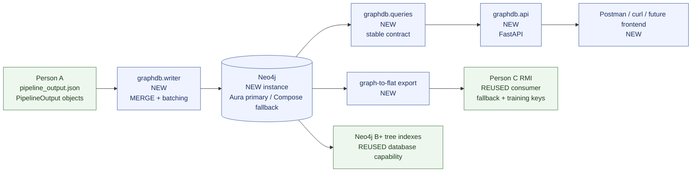

# Architecture diagram

Mermaid source for the Graph DB & Backend lane. The same diagram is embedded in
[../ARCHITECTURE.md](../ARCHITECTURE.md).

## Legend

- **REUSED** — existing project or database capability; this lane consumes it without changing it.
- **NEW** — implemented or configured by this lane.

## Notes

- Aura is the working Neo4j instance; Docker Compose is a documented but currently untested alternative.
- The writer consumes both `PipelineOutput` objects and the JSON shape from `pipeline/export.py`.
- Person C consumes both `graphdb/queries.py` and the flat event-key export.
- The API is a thin layer over `queries.py`; it does not contain graph logic.
