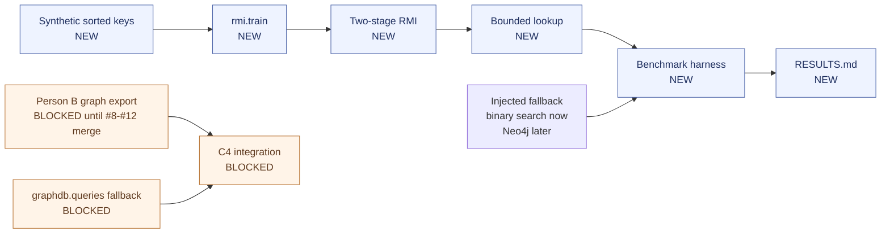

# Architecture — Research/RMI lane

## 1. Position in the project

The lane is independent of the graph/backend implementation until the final integration PR.



## 2. Components

| Component | Status | Responsibility |
|---|---|---|
| `rmi/config.py` | **C1 complete** | Config-driven stage model names and bucket count |
| `rmi/keys.py` | **C1 complete** | Deterministic synthetic uniform/clustered sorted keys and queries |
| `rmi/model.py` | **C1 complete** | Stage-1 bucket router, stage-2 local models, error windows, bounded lookup |
| `rmi/train.py` | **C1 complete** | `train_rmi`, idempotent `retrain_rmi`, CLI summary |
| `rmi/benchmark.py` | **C2 planned** | Same-query-set RMI vs injected fallback benchmark |
| `rmi/drift.py` | **C3 planned** | New-key drift experiment before/after retraining |
| `rmi/fallback.py` | **C4 blocked** | Thin adapter around `graphdb.queries` |

## 3. RMI algorithm

### Training

1. Validate the input is sorted, unique, non-empty integer keys.
2. Split keys into equal-count buckets, clamped to at most the number of keys.
3. Train stage 1 on `key → normalized global position`.
4. Compute the true bucket for every key and the maximum stage-1 bucket error.
5. Train one stage-2 model per bucket on `key → local position`.
6. Store each bucket's maximum stage-2 error as an integer correction window.

### Lookup

1. Reject keys outside `[min_key, max_key]` as `out_of_range` fallback.
2. Predict the bucket with stage 1.
3. Search candidate buckets within the stage-1 error bound.
4. Inside each candidate bucket, predict a local position and search `± stage2_error`.
5. Return the exact index on a hit; otherwise return `not_found` fallback.

This is the correctness guarantee: if the training error bounds are correct, every training key is inside
the searched window. It is tested for union of linear/constant model choices.

## 4. Interfaces

### Input

```python
keys: numpy.ndarray  # sorted, unique, int64
```

### Config

```python
RMIConfig(stage_models=("linear", "linear"), bucket_count=128)
```

Environment variables:

```dotenv
RMI_STAGE_MODELS=linear,linear
RMI_BUCKET_COUNT=128
```

### Lookup result

```python
LookupResult(
    found: bool,
    index: int | None,
    candidates_checked: int,
    used_fallback: bool,
    reason: str | None,
)
```

### Future fallback

C4 will wire the injected fallback to Person B's stable functions:

```python
graphdb.queries.events_in_date_range(start, end)
graphdb.queries.event_by_id(event_id)
```

The RMI lookup itself predicts positions in the sorted `date_key` array; the Neo4j fallback answers the same
date-key query set so the benchmark compares like with like.

## 5. Design decisions

- [ADR-0001](decisions/ADR-0001-rmi-model-config-and-error-bounds.md) — two-stage model, config-driven
  stages, error-bound correctness.
- [ADR-0002](decisions/ADR-0002-fallback-benchmark-contract.md) — injected fallback and same-query-set
  benchmark contract.
- [ADR-0003](decisions/ADR-0003-retrain-drift-experiment.md) — idempotent retraining and drift experiment.

## 6. Boundaries and blockers

- No file in `graphdb/`, `common/`, `pipeline/`, `scripts/`, or the root docs is edited.
- C4 is blocked by Person B PRs #8–#12 and a reachable Neo4j `.env`.
- Docker Compose is not required for C1–C3.

## 7. Extension path

- Add a model name → factory entry in `rmi/model.py`.
- Support additional stages by replacing the two-stage construction with a recursive stage tree; the config
  already carries a stage list.
- Replace `linear` with a richer per-stage model behind the same `NumericModel` protocol.
- Replace the injected fallback with `graphdb.queries` in C4.
