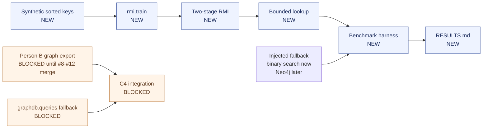

# Architecture diagram

Standalone Mermaid source for the Research/RMI lane. The same diagram is embedded in
[../ARCHITECTURE.md](../ARCHITECTURE.md).

## Notes

- C1–C3 are independent of Person B.
- C4 requires Person B's PRs #8–#12 to merge first.
- The fallback is injected, so the benchmark harness does not import `graphdb` until C4.
